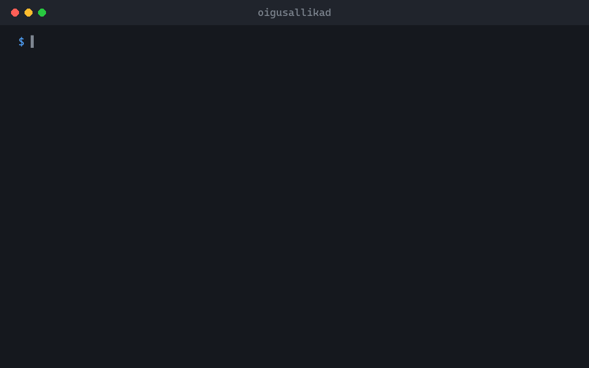

<p align="center">
  
</p>

<h1 align="center">oigusallikad</h1>

<p align="center">
  Toob Eesti seaduse sätte, kohtulahendi punkti või ELi akti artikli otse ametlikust allikast.<br>
  <sub>Käsurea tööriist ja MCP server, et AI-assistent tsiteeriks päris teksti, mitte ei arvaks.</sub>
</p>

<p align="center"><a href="https://github.com/Ker102/oigusallikad#readme">English</a> · <b>Eesti</b></p>

<p align="center">
  
</p>

<p align="center">
  <a href="https://github.com/Ker102/oigusallikad/releases/latest"><b>Laadi alla</b></a> &nbsp;·&nbsp; <a href="#alustamine">Alustamine</a> &nbsp;·&nbsp; <a href="https://github.com/Ker102/oigusallikad/blob/main/docs/juhend.md">Täielik juhend</a>
</p>

<p align="center">
  <sub>Töötab koos</sub><br>
  &nbsp;Claude Code &nbsp;·&nbsp; <picture><source media="(prefers-color-scheme: dark)" srcset="https://raw.githubusercontent.com/Ker102/oigusallikad/assets/brands/modelcontextprotocol-dark.svg"></picture>&nbsp;MCP &nbsp;·&nbsp; &nbsp;EUR-Lex &nbsp;·&nbsp; &nbsp;Go
</p>

## Mida see teeb

Küsi sätet, näiteks seaduse § 98 lg 3, Riigikohtu lahendi punkti 13 või direktiivi artiklit 15, ja see toob ainult selle teksti Riigi Teatajast, Riigikohtu lahendite andmebaasist või EUR-Lexist. Iga vastusega on kaasas link algallikale.

- Ainult vajalik osa, mitte terve veebileht, nii et assistendi vastused jäävad lühikeseks ja täpseks.
- Ka varasemad redaktsioonid: küsi, mida seadus mingil kuupäeval ütles.
- Kui allikas muutub või blokeerib päringu, öeldakse see selgelt välja, mitte ei anta vale või tühja vastust.

> [!NOTE]
> Tööriist kasutab ainult avalikke ametlikke liideseid viisaka sagedusega ega ürita blokeeringutest mööda minna. Kontrolli tsiteeritud teksti enne kasutamist lingitud algallikast.

## Alustamine

1. Laadi oma arvuti jaoks programm alla <a href="https://github.com/Ker102/oigusallikad/releases/latest">viimasest väljalaskest</a> ja paki lahti. (Kui Go on olemas, sobib ka <code>go install github.com/Ker102/oigusallikad/cmd/oigusallikad@latest</code>.)
2. Ühenda see Claude Code'iga: <code>claude mcp add oigusallikad -- /tee/oigusallikad mcp</code>
3. Küsi tavaliste sõnadega, näiteks: <i>„Mida ütleb THS § 98 lg 3 ja kas Riigikohus on seda tõlgendanud?“</i>
4. Või käivita see ise terminalis:

```bash
oigusallikad sate -t THS 98 -lg 3
```

## Mida on vaja

- Windows, macOS või Linux ning internetiühendus.
- <code>pdftotext</code> (Poppleri osa) PDF-ina avaldatud kohtulahendite jaoks.
- Claude Code, Claude Desktop või mõni muu MCP-d toetav assistent, kui tahad, et AI seda sinu eest kasutaks.

## Mis on sees

- [`cmd/oigusallikad/`](https://github.com/Ker102/oigusallikad/blob/main/cmd/oigusallikad/) · Programm: käsurida ja MCP server.
- [`internal/`](https://github.com/Ker102/oigusallikad/blob/main/internal/) · Iga allika lugeja (Riigi Teataja, kohtulahendid, EUR-Lex) ja kontrollid, mis märkavad, kui allikas muutub.
- [`skills/oigusallikad/SKILL.md`](https://github.com/Ker102/oigusallikad/blob/main/skills/oigusallikad/SKILL.md) · Ütleb AI-agendile, millal ja kuidas tööriista kasutada.
- [`docs/juhend.md`](https://github.com/Ker102/oigusallikad/blob/main/docs/juhend.md) · Täielik juhend: kõik käsud, allikad ja piirangud.

<sub>Eelvaate pildid on harus <a href="https://github.com/Ker102/oigusallikad/tree/assets"><code>assets</code></a> ja tõlked harus <a href="https://github.com/Ker102/oigusallikad/tree/translations"><code>translations</code></a>, nii et <code>main</code> sisaldab ainult tööriista.</sub>

## Sõsarprojekt

<a href="https://github.com/Ker102/lepinguparser"></a>
**[lepinguparser](https://github.com/Ker102/lepinguparser)**<br>
Kontrollib sinu enda lepinguid: katkised punktiviited, defineerimata terminid ja eesti käändevormid Wordi failides, PDF-ides ja DigiDoc konteinerites.
<br clear="left">

---

<sub>Apache 2.0 koos Commons Clause'iga: kasutamine vaba, müük keelatud · <a href="https://github.com/Ker102">Ker102</a></sub>
