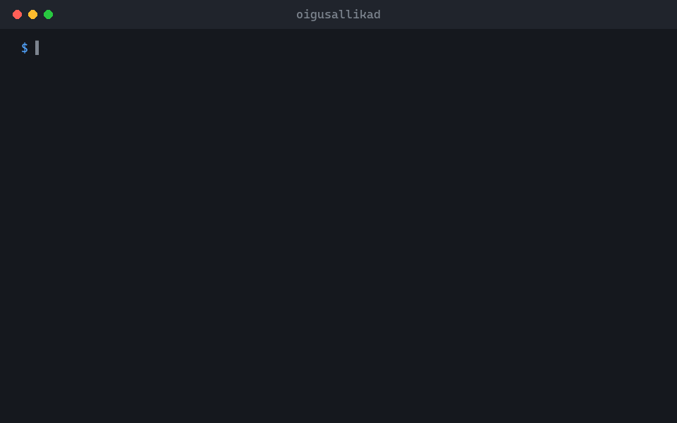

<p align="center">
  
</p>

<h1 align="center">oigusallikad</h1>

<p align="center">
  Gives you the exact section of an Estonian law, a court ruling or an EU act, straight from the official source.<br>
  <sub>A command-line tool and MCP server, so AI assistants quote the real text instead of guessing it.</sub>
</p>

<p align="center"><b>English</b> · <a href="https://github.com/Ker102/oigusallikad/blob/translations/README.et.md">Eesti</a></p>

<p align="center">
  
</p>

<p align="center">
  <a href="https://github.com/Ker102/oigusallikad/releases/latest"><b>Download</b></a> &nbsp;·&nbsp; <a href="#get-started">Get started</a> &nbsp;·&nbsp; <a href="docs/juhend.md">Full guide (Estonian)</a>
</p>

<p align="center">
  <sub>Works with</sub><br>
  &nbsp;Claude Code &nbsp;·&nbsp; <picture><source media="(prefers-color-scheme: dark)" srcset="https://raw.githubusercontent.com/Ker102/oigusallikad/assets/brands/modelcontextprotocol-dark.svg"></picture>&nbsp;MCP &nbsp;·&nbsp; &nbsp;EUR-Lex &nbsp;·&nbsp; &nbsp;Go
</p>

## What it does

Ask for a provision, such as § 98 lg 3 of a law, point 13 of a Supreme Court ruling or Article 15 of a directive, and it fetches just that text from Riigi Teataja, the Supreme Court's database or EUR-Lex. Every answer comes with a link to the source.

- Only the part you need, not a whole web page, so an assistant's answers stay short and accurate.
- Past versions too: ask what a law said on a given date.
- If a source changes or blocks the request, it says so plainly instead of returning a wrong or empty answer.

> [!NOTE]
> It uses only public, official interfaces at a polite pace and never tries to get around a block. Check quoted text at the linked source before relying on it.

## Get started

1. Download the program for your computer from the <a href="https://github.com/Ker102/oigusallikad/releases/latest">latest release</a> and unzip it. (With Go installed you can also run <code>go install github.com/Ker102/oigusallikad/cmd/oigusallikad@latest</code>.)
2. Connect it to Claude Code: <code>claude mcp add oigusallikad -- /path/to/oigusallikad mcp</code>
3. Ask in plain words, for example: <i>“What does THS § 98 lg 3 say, and has the Supreme Court interpreted it?”</i>
4. Or run it yourself in a terminal:

```bash
oigusallikad sate -t THS 98 -lg 3
```

## What you need

- Windows, macOS or Linux, and an internet connection.
- <code>pdftotext</code> (part of Poppler) for court rulings that are published as PDFs.
- Claude Code, Claude Desktop or another MCP-capable assistant, if you want AI to use it for you.

## What's inside

- [`cmd/oigusallikad/`](cmd/oigusallikad/) · The program: command line and MCP server.
- [`internal/`](internal/) · One reader per source (Riigi Teataja, court rulings, EUR-Lex) and the checks that notice when a source changes.
- [`skills/oigusallikad/SKILL.md`](skills/oigusallikad/SKILL.md) · Tells an AI agent when and how to use the tool.
- [`docs/juhend.md`](docs/juhend.md) · The full guide in Estonian: every command, source and limit.

<sub>Preview media lives on the <a href="https://github.com/Ker102/oigusallikad/tree/assets"><code>assets</code></a> branch and translations on <a href="https://github.com/Ker102/oigusallikad/tree/translations"><code>translations</code></a>, so <code>main</code> holds only the tool.</sub>

## Sister project

<a href="https://github.com/Ker102/lepinguparser"></a>
**[lepinguparser](https://github.com/Ker102/lepinguparser)**<br>
Checks your own contracts for broken clause references, undefined terms and Estonian word forms, in Word, PDF and DigiDoc containers.
<br clear="left">

---

<sub>Apache 2.0 with Commons Clause: free to use, not to sell · <a href="https://github.com/Ker102">Ker102</a></sub>
